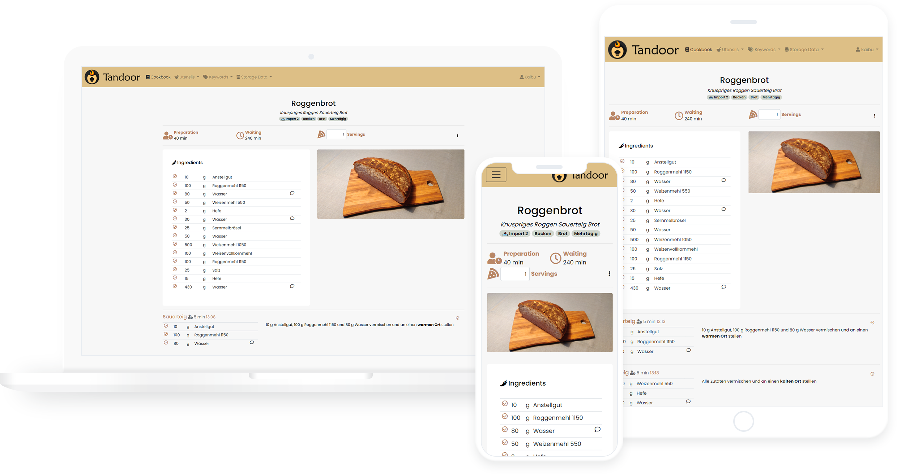

<h1 align="center">
  <br>
  
  <br>
  Tandoor Recipes
  <br>
</h1>

<h4 align="center">The recipe manager that allows you to manage your ever growing collection of digital recipes.</h4>

<p align="center">
  <a href="https://github.com/hulamanisrinish-cpu/Tandoor-Recipes/stargazers" target="_blank" rel="noopener noreferrer"></a>
  <a href="https://github.com/hulamanisrinish-cpu/Tandoor-Recipes/network/members" target="_blank" rel="noopener noreferrer"></a>
  <a href="https://github.com/hulamanisrinish-cpu/Tandoor-Recipes/releases/latest" target="_blank" rel="noopener noreferrer"></a>
  
  
  
</p>

<p align="center">
  <a href="#-quick-start">Quick Start</a> •
  <a href="#-features">Features</a> •
  <a href="#%EF%B8%8F-tech-stack">Tech Stack</a> •
  <a href="#-development">Development</a> •
  <a href="#-documentation">Documentation</a> •
  <a href="#-license">License</a>
</p>



## 📖 About

Tandoor Recipes is a self-hosted web application for organizing your digital recipe collection.
Store all your recipes in one searchable place, plan your meals for the week, build shopping
lists automatically, and collaborate on everything with family and friends — all on your own
server, with your own data.

I maintain this project and use it as my personal recipe hub, and I keep improving it with
features, fixes, and cleanups that matter for day-to-day use.

## ✨ Features

- 🥗 **Manage your recipes** — manage your ever growing recipe collection
- 📆 **Plan** — multiple meals for each day
- 🛒 **Shopping lists** — via the meal plan or straight from recipes
- 🪄 **Use AI** to recognize images, sort recipe steps, find nutrition facts and more
- 📚 **Cookbooks** — collect recipes into books
- 👪 **Share and collaborate** on recipes with friends and family

### Made by and for power users

- 🔍 Powerful & customizable **search** with fulltext support and TrigramSimilarity
- 🏷️ Create and search for **tags**, assign them in batch to all files matching certain filters
- ↔️ Quickly merge and rename ingredients, tags and units
- 📥️ **Import recipes** from thousands of websites supporting [ld+json or microdata](https://schema.org/Recipe)
- ➗ Support for **fractions** or decimals
- 🐳 Easy setup with **Docker** and included examples for Kubernetes, Unraid and Synology
- 🎨 Customize your interface with **themes**
- 📦 **Sync** files with Dropbox and Nextcloud

### All the must haves

- 📱 Optimized for use on **mobile** devices
- 🌍 Localized in many languages
- 📥️ **Import your collection** from many other recipe managers (see `docs/features/import_export.md`)
- ➕ Many more like recipe scaling, image compression, printing views and supermarkets

This application is meant for people with a collection of recipes they want to share with family
and friends or simply store in a nicely organized way. A basic permission system exists, but the
application is not meant to be run as a public page.

## 🚀 Quick Start

The easiest way to run Tandoor is with **Docker Compose**.

### 1. Prepare the environment

```bash
mkdir tandoor && cd tandoor

# download the environment template and fill in SECRET_KEY and POSTGRES_PASSWORD
curl -L https://raw.githubusercontent.com/hulamanisrinish-cpu/Tandoor-Recipes/develop/.env.template -o .env
```

> 💡 Generate a `SECRET_KEY` with `base64 /dev/urandom | head -c50`.
> For local testing you can set `ALLOWED_HOSTS=*`.

### 2. Create a `docker-compose.yml`

```yaml
services:
  db_recipes:
    restart: always
    image: postgres:16-alpine
    volumes:
      - ./postgresql:/var/lib/postgresql/data
    env_file:
      - ./.env

  web_recipes:
    restart: always
    image: ghcr.io/hulamanisrinish-cpu/recipes:latest
    env_file:
      - ./.env
    ports:
      - 80:80
    volumes:
      - staticfiles:/opt/recipes/staticfiles
      - ./mediafiles:/opt/recipes/mediafiles
    depends_on:
      - db_recipes

volumes:
  staticfiles:
```

### 3. Start it

```bash
docker compose up -d
```

Open `http://localhost` and create your account. Done! 🎉

> **Prefer building the image yourself?**
> ```bash
> git clone https://github.com/hulamanisrinish-cpu/Tandoor-Recipes.git
> cd Tandoor-Recipes
> docker build -t ghcr.io/hulamanisrinish-cpu/recipes:latest .
> ```

Additional compose examples (nginx, Apache, Traefik, IPv6) live in
[`docs/install/docker/`](docs/install/docker/).

## 🛠️ Tech Stack

| Layer      | Technology                                        |
|------------|---------------------------------------------------|
| Backend    | Python, Django, Django REST Framework             |
| Frontend   | Vue 3, Vuetify, Vite                              |
| Database   | PostgreSQL (with fulltext search & trigram index) |
| Serving    | Gunicorn + Nginx (bundled in the Docker image)    |
| Deployment | Docker / Docker Compose, GitHub Actions CI        |

## 💻 Development

### Backend

```bash
git clone https://github.com/hulamanisrinish-cpu/Tandoor-Recipes.git
cd Tandoor-Recipes

python -m venv venv
source venv/bin/activate          # Windows: venv\Scripts\activate
pip install -r requirements.txt

cp .env.template .env             # fill in SECRET_KEY and database credentials

python manage.py migrate
python manage.py collectstatic --noinput
python manage.py runserver
```

> A running PostgreSQL instance is required — see `.env.template` for the expected variables.

### Frontend

```bash
cd vue3
yarn install
yarn serve
```

### Tests

```bash
pytest
```

## 📚 Documentation

The full documentation lives in the [`docs/`](docs/) folder and covers installation,
configuration, backup/restore, and every feature in depth. Build it locally with:

```bash
pip install mkdocs-material mkdocs-include-markdown-plugin
mkdocs serve
```

## 🙏 Acknowledgements

This project builds on **Tandoor Recipes** by [vabene1111](https://github.com/vabene1111/recipes) —
an outstanding open-source recipe manager. Thanks to everyone who contributed to the original
project over the years.

## 📄 License

Licensed under the **GNU AGPL v3** with a [Commons Clause](https://commonsclause.com/) selling
exception. See [LICENSE.md](LICENSE.md) for details.

> **Note:** This software and *all* its features are and will always be free for everyone to use
> and enjoy. The selling exception only prevents others from selling hosted versions of the
> software itself — it does not restrict personal, family, or community use in any way.
